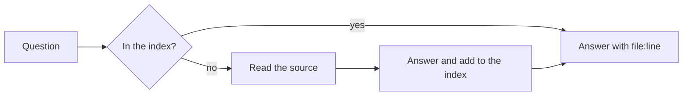
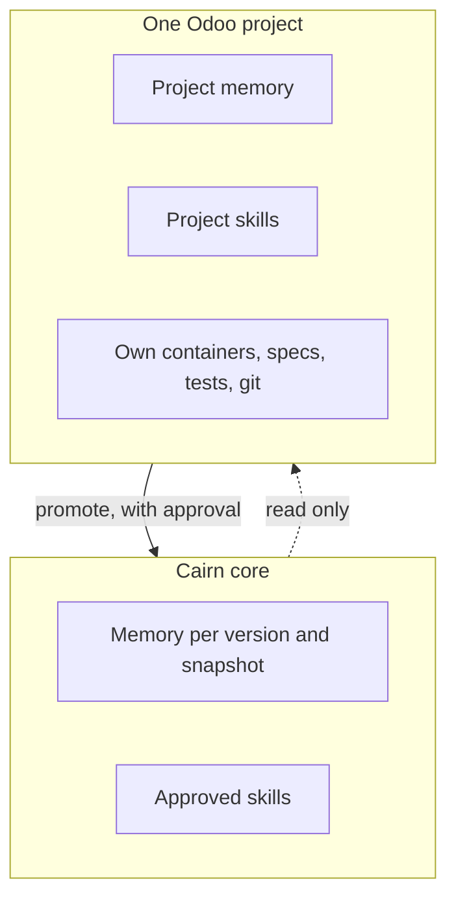

<p align="center">
  <picture>
    <source media="(prefers-color-scheme: dark)" srcset="assets/logo-dark.svg">
    
  </picture>
</p>

<h1 align="center">Cairn</h1>

<p align="center"><strong>Every stone has a source.</strong><br>A source-first agent for building Odoo.</p>

> **Status: design complete, implementation in progress.** Nothing below is claimed as working until its milestone is checked in [ROADMAP.md](ROADMAP.md). <!-- UPDATE this line as milestones land. -->

---

## The problem

General-purpose AI assistants answer Odoo questions from training data. Odoo changes between versions, and even within one version over time, so confident answers are often wrong in small, expensive ways: a renamed method, a moved field, a changed view structure.

## The idea

Cairn is an agent for Odoo development, implementation and customization that **learns only from the Odoo source code you give it** and shows its evidence.

- Every stored fact carries `file:line`, the Odoo version, a snapshot id and a file hash.
- If it has no source for a claim, it says **unverified** instead of guessing.
- Knowledge is kept **per Odoo version and per source snapshot**, so "Odoo 19 in January" and "Odoo 19 in October" never get mixed.
- It grows only with your approval. Each new skill or imported knowledge is a stone you chose to add.

## How a question is answered



A read tracker records what has been read and what remains, so coverage is measurable.

## Two layers, strict isolation



Each project is isolated. Nothing moves up to the core unless you approve it.

## Design goals (planned capabilities)

| Area | Goal |
|---|---|
| Knowledge | Deterministic structural indexing of Odoo source, immutable snapshots with shared objects, coverage tracking, same-version refresh |
| Building | Module scaffolding, customization, front-end (views, OWL, QWeb), cross-version migration |
| Running | Dev-container control, module install and upgrade, a debug loop |
| Quality | Odoo conventions and clean code, Big-O and query-count analysis, a quality gate aligned with ISO/IEC 25010 (aligned with, not certified) |
| Process | Functional knowledge layer, fit-gap, spec-driven development (method pluggable) |
| Governance | Consent gate for skills, quarantine for imports, versioned agent with rollback |

Full details: [docs/ARCHITECTURE.md](docs/ARCHITECTURE.md), [docs/DESIGN_DECISIONS.md](docs/DESIGN_DECISIONS.md), [docs/THREAT_MODEL.md](docs/THREAT_MODEL.md).

## What is deliberately not in this repository

- Odoo source code, or any knowledge index derived from it
- Anything derived from Odoo Enterprise
- Personal data, client or employer material, credentials

Cairn builds its knowledge locally from source **you** provide.

## Limitations (honest)

- Hooks and permission rules reduce risk but are guardrails, not a sandbox. Run it on a dev machine with no production credentials.
- Its answers are only as good as the source and the index it has built. Low coverage means more "unverified".
- It targets Claude Code. Conventions of that tool may change.

## Repository layout

```
tools/        deterministic Python tooling (index, snapshot, query, verify, coverage, scan, pack)
skills/       approved agent skills (each with a help file)
templates/    project, compose, spec and report templates
docs/         architecture, decisions, threat model
tests/        unit tests and a fictional fixture addon tree
assets/       logo
```

## Disclaimer

Cairn is an independent project. It is not affiliated with, endorsed by, or sponsored by Odoo S.A. "Odoo" is a trademark of its owner.

## Author

Designed and built by [Ahmad Sultan](https://engahmdsltn-ops.github.io/portfolio/). Website: https://engahmdsltn-ops.github.io/cairn-odoo-agent/

## License

[MIT](LICENSE). See [SECURITY.md](SECURITY.md) for reporting vulnerabilities.
